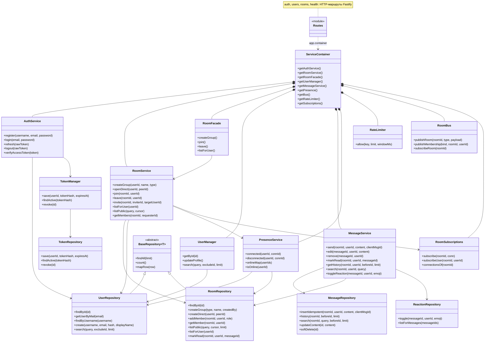
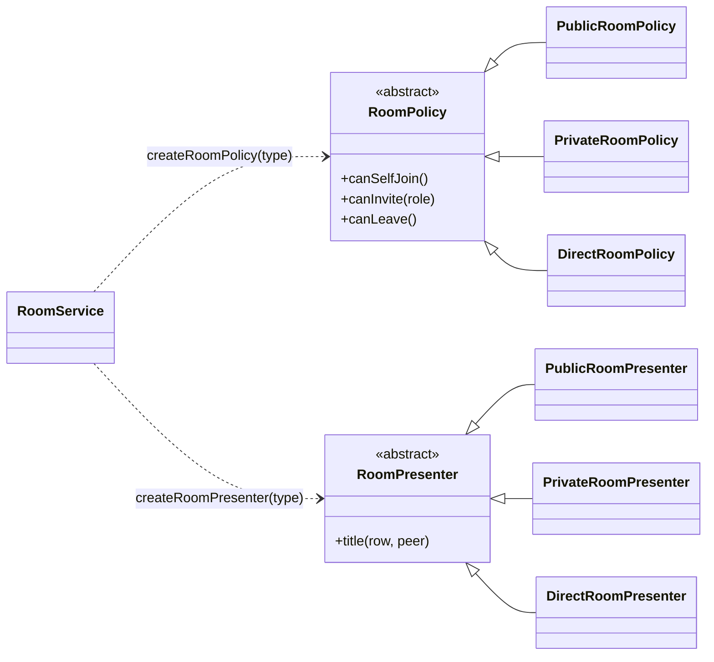
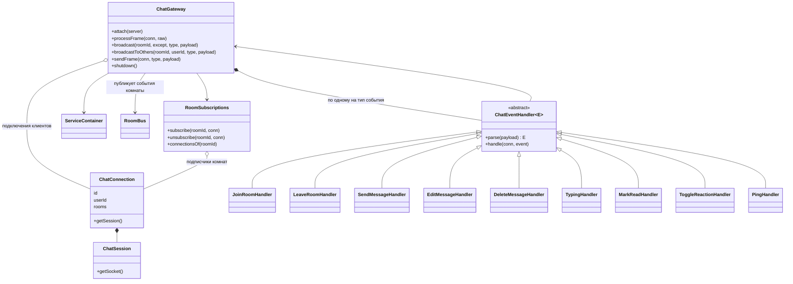
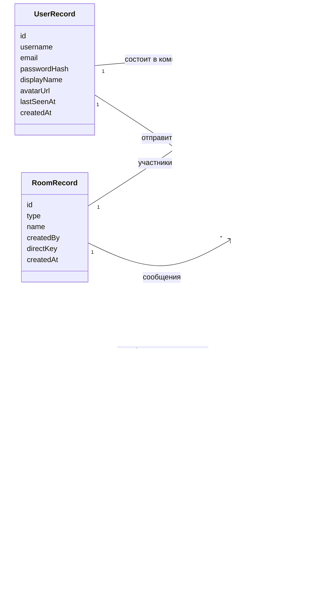
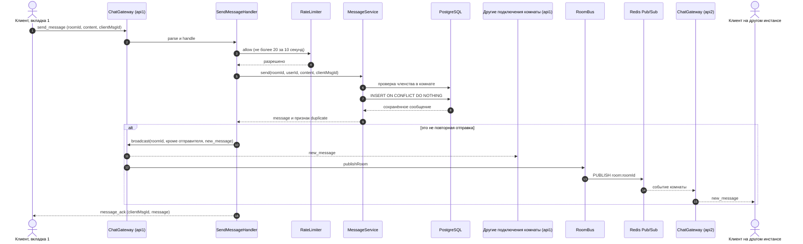

# UML-диаграммы бэкенда

Диаграммы нарисованы в формате Mermaid: GitHub показывает их прямо на странице. Они описывают бэкенд (`backend/src`) и показывают, из каких классов он состоит и как они связаны. Общая схема системы (браузер, Nginx, два инстанса, Redis, PostgreSQL) приведена в [README](../README.md#архитектура).

Обозначения: `<|--` наследование, `*--` композиция (один объект создаёт и хранит другой), `-->` ассоциация (класс держит ссылку на другой и вызывает его), `..>` зависимость (класс только пользуется другим).

## 1. Слои: маршруты, сервисы, репозитории

Запрос идёт сверху вниз: маршрут Fastify берёт нужный сервис из `ServiceContainer`, сервис вызывает репозитории, репозитории выполняют SQL в PostgreSQL.

## 2. Правила комнат и заголовки комнат по типам

Для трёх типов комнат (публичная, приватная, личный диалог) есть две отдельные иерархии: правила (кто может войти, пригласить, выйти) и заголовок в списке комнат. Нужный класс выбирают фабричные функции `createRoomPolicy(type)` и `createRoomPresenter(type)`.

## 3. WebSocket: шлюз, подключения и обработчики событий

`ChatGateway` принимает кадры от клиентов, разбирает конверт `{ type, payload }` и передаёт событие нужному обработчику. Каждый тип события обрабатывает свой класс-наследник `ChatEventHandler`. Рассылку подключениям комнаты и по шине между инстансами выполняет шлюз.

## 4. Модели данных

Записи таблиц БД (`UserRecord`, `RoomRecord`, `MemberRecord`, `MessageRecord`) и объекты, которые сервисы отдают клиентам (`RoomSummaryDto`, `MemberInfoDto`).

## 5. Последовательность: отправка сообщения

Клиент отправляет `send_message` по WebSocket на один инстанс, а получатель подключён ко второму. Сообщение сохраняется один раз, отправитель получает `message_ack`, остальные подключения комнаты на первом инстансе получают `new_message` напрямую, а на втором через Redis Pub/Sub.

